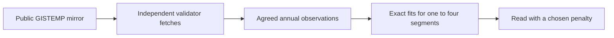

# Breakline

Breakline publishes exact change-point fits for independently observed annual data. One observation produces four onchain models, so readers can change the complexity penalty without acquiring the data again.

[Contract source](contracts/breakline.py) · [Public data fixture](fixtures/global-temp-annual.csv) · [StudioNet proof](#studionet-proof) · [Submission text](SUBMISSION.md)

## From observations to change points



| Method | Result |
| --- | --- |
| `publish(revision)` | Fetch the annual CSV from a full upstream commit, verify its observations through consensus, and publish the exact models. |
| `get_study(study_id)` | Read the source, normalized values, segment bounds, means, and fitting error. |
| `choose(study_id, penalty_centi_c2)` | Select the model minimizing squared error plus the supplied penalty per cut. |

The leader and each validator independently fetch the entire CSV. Each extracts all 24 GISTEMP observations for 2000–2023, rounds to the nearest hundredth of a degree Celsius with ties to even, and checks for missing or duplicate years. Consensus requires exact agreement on the complete normalized series. The data come from the public `datasets/global-temp` mirror of NASA GISS's global land-ocean series. [Pinned upstream data](https://github.com/datasets/global-temp/blob/b90e8a349acb508d382d40d1cfa393c723bd82ef/data/annual.csv) · [NASA GISTEMP v4](https://data.giss.nasa.gov/gistemp/)

For each segment count, dynamic programming minimizes within-segment squared error with a three-year minimum segment size. The returned means and costs are reduced rational pairs. Ties use the earliest cut sequence, and penalty ties select fewer segments. The fitted cuts describe this dataset and year window under the chosen objective.

The fixture extracts the selected GISTEMP rows from the upstream data package, which is attributed to DataHub's `datasets/global-temp` and distributed under CC BY 4.0. NASA GISTEMP values originate from NASA Goddard Institute for Space Studies. [Upstream attribution](https://github.com/datasets/global-temp#license)

## Verify locally

```sh
python -m pip install -r requirements-dev.txt
genvm-lint download --version v0.2.16
genvm-lint check contracts/breakline.py
python -m pytest tests/direct -q
```

Direct tests check all four optimal models against exhaustive enumeration, compare changed verifier input, and reject incomplete or malformed data.

## StudioNet proof

Two finalized publications returned the same study ID. Read-only replay checks the deployed bytes, all three finalized receipts, all four fitted models, and the readbacks for three complexity penalties.

| Penalty per cut in squared hundredths of a degree | Selected segments | Years starting a new segment |
| ---: | ---: | --- |
| 0 | 4 | 2005, 2015, 2019 |
| 1,000 | 2 | 2015 |
| 1,000,000 | 1 | |

[Deployed contract](https://explorer-studio.genlayer.com/address/0xA45Fd551fabb0f9072a4Ba95e67791E20F5eBa8e) · [Proof ledger](proofs/studionet.json) · [GenVM checks](https://github.com/mohammadisina1988-jpg/breakline/actions/runs/45766380817)

```sh
npm ci
npm run verify
```
